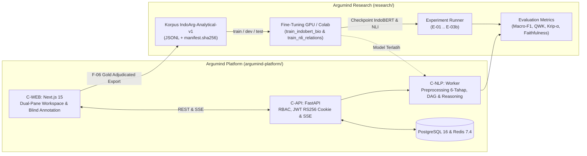

# Argumind

Ekosistem terpadu **Explainable Argument Mining, Implicit Premise Detection, and Critical Reasoning Assessment** untuk teks analitis berbahasa Indonesia.

Repositori ini mengelola dua komponen yang saling terhubung dalam satu ruang kerja:
1. **[Argumind Platform (`argumind-platform/`)](argumind-platform/README.md)** — Monorepo aplikasi web produksi (*Next.js 15 + FastAPI + NLP Worker + PostgreSQL 16 + Redis 7.4*) untuk analisis struktur argumen secara visual (*Dual-Pane Workspace*), penilaian rubrik terjelaskan, dan ruang kerja anotasi *double-blind*.
2. **Argumind Research (`research/`)** — Kerangka penelitian komputasional, skrip *fine-tuning* model bahasa (`IndoBERT` & *Cross-Encoder NLI*), *runner* eksperimen terstandardisasi (`E-01`–`E-03b`), notebook pelatihan **Google Colab GPU**, dan dokumentasi naskah publikasi ilmiah:
   > *"Explainable Argument Mining and Implicit Premise Detection for Evaluating Critical Reasoning in Indonesian Analytical Texts"*

---

## Arsitektur Ekosistem & Alur Terpadu



---

## Struktur Direktori Repositori (`d:\argumind`)

```text
argumind/
├── README.md                          # Dokumentasi utama ekosistem (Platform + Riset)
├── pyproject.toml                     # Konfigurasi paket Python, Ruff, Mypy, & Pytest workspace
├── .gitignore                         # Aturan pengecualian .venv, build web, & artefak sementara
├── .venv/                             # Virtual environment Python lokal (dibuat dengan uv)
│
├── argumind-platform/                 # PILAR 1: Produk & Layanan Web Monorepo
│   ├── README.md                      # Dokumentasi teknis & panduan pengembangan produk murni
│   ├── AGENTS.md                      # Panduan operasional agen AI & peta baca dokumen
│   ├── package.json                   # Konfigurasi PNPM workspace
│   ├── pnpm-workspace.yaml
│   ├── apps/
│   │   ├── web/                       # Frontend Next.js 15, React 19, Tailwind CSS 4, @xyflow/react
│   │   ├── api/                       # Backend FastAPI, RBAC (OWN/ORG/BLIND), Auth JWT RS256 + MFA
│   │   └── nlp-worker/                # Preprocessing 6 tahap, Chu-Liu/Edmonds DAG, & graph reasoning
│   ├── packages/
│   │   ├── shared-schemas/            # Kontrak skema lintas-bahasa (Pydantic v2 & TypeScript Zod)
│   │   └── evaluation-metrics/        # Implementasi Macro-F1, QWK, α_Krip, Spearman, FaithfulnessRate
│   ├── infra/
│   │   ├── docker/docker-compose.yml  # Kontainer lokal PostgreSQL 16 & Redis 7.4
│   │   └── migrations/001_initial_schema.sql # Skema SQL 9 tabel inti + B-Tree & GIN indexes
│   └── docs/                          # 12 dokumen spesifikasi teknik & produk + preview palet warna
│
└── research/                          # PILAR 2: Riset Ilmiah, Pelatihan Model & Eksperimen
    ├── RESEARCH_BRIEF.md              # Masalah, celah riset, RQ1–RQ3, H1–H3b, & definisi konstruk
    ├── LITERATURE_REVIEW.md           # Tinjauan pustaka 2020–2025 (10 studi ACL Anthology terverifikasi)
    ├── references.bib                 # Bibliografi BibTeX terverifikasi URL & DOI
    ├── METHODOLOGY.md                 # Desain eksperimen, pipeline 3 tahap, & rumus statistik
    ├── EXPERIMENT_PLAN.md             # Matriks skenario E-01 s.d. E-03b, seed, & kriteria sukses
    ├── EXPERIMENT_LOG.md              # Buku log eksekusi eksperimen append-only
    ├── DATASET.md                     # Datasheet korpus IndoArg-Analytical-v1 & aturan imutabilitas
    ├── ETHICS.md                      # Protokol etik UU PDP, informed consent, & redaksi PII
    ├── JOURNAL_TARGET.md              # Target jurnal gratis ($0 APC): TACL, IP&M, IJAIED
    ├── REPRODUCIBILITY.md             # Kontrol seed, lingkungan deterministik, & checksum manifest
    ├── AI_USAGE.md                    # Kebijakan penggunaan AI & templat deklarasi penerbit
    ├── RESEARCH_PROGRESS.md           # Pelacak fase riset, milestone M1–M5, & status naskah
    ├── AUTHORS_CONTRIBUTIONS.md       # Draf CRediT penulis (ditunda sesuai arahan pengguna)
    ├── data/
    │   ├── raw/                       # READ-ONLY: Direktori data mentah imutabel
    │   └── processed/v1.0/            # Korpus benih (seed sample) tervalidasi manifest.sha256
    ├── runners/                       # Skrip CLI pelatihan IndoBERT/NLI, determinism, & run_experiment
    ├── notebooks/
    │   └── Argumind_Colab_Training.ipynb # Notebook Google Colab GPU siap pakai
    ├── outputs/                       # Artefak hasil run (config_locked, predictions, metrics_raw, log)
    └── tests/                         # Smoke test pipeline eksperimen (test_runner_smoke.py)
```

---

## Bagian I — Argumind Platform (`argumind-platform/`)

**Argumind Platform** dirancang untuk menanggulangi lambatnya peninjauan argumen manual serta masalah ketidakjelasan (*unfaithful explanation*) pada *chatbot* AI umum. Panduan teknis terpisah khusus tim pengembang produk tersedia di [`argumind-platform/README.md`](argumind-platform/README.md).

### Kemampuan Inti Sistem (`F-01` – `F-07`)

1. **`F-01` Ingesti & Ekstraksi Komponen**: Validasi dokumen `.txt`, `.md`, `.docx`, `.pdf` (`300–2.500` kata), normalisasi UTF-8/NFKC tanpa *case-folding*, redaksi PII otomatis (`[REDACTED_NAME]`, `[REDACTED_ID]`, `[REDACTED_EMAIL]`), serta pelabelan rentang karakter `Claim`, `ExplicitPremise`, dan `Evidence` (`Done`).
2. **`F-02` Pemetaan Relasi & Visualisasi Graf DAG**: Klasifikasi relasi berarah `Support` dan `Attack`, dekode *Chu-Liu/Edmonds maximum spanning arborescence* (`cycle_rate == 0.0` untuk `Support`), dan sinkronisasi dua arah kanvas `@xyflow/react` dengan teks sumber ($\le 100\text{ ms}$) (`Done`).
3. **`F-03` Rekonstruksi Premis Implisit & Celah Penalaran**: Sisipan node jembatan `ImplicitPremise` serta pelabelan 6 kategori `ReasoningGap` (`UnsupportedClaim`, `HastyGeneralization`, `FalseCause`, `CircularReasoning`, `MissingCounterargumentConsideration`, `WeakEvidence`) (`In Progress` — stub deterministik aktif menuju integrasi `EXT-LLM`).
4. **`F-04` Penilaian Rubrik 4 Dimensi Terjelaskan**: Skor integer `1..5` untuk `ClarityOfClaim`, `PremiseSupportAndCoherence`, `EvidenceAdequacy`, dan `CounterargumentAndLimitationAwareness`, wajib melampirkan `grounded_refs` (`>= 1` ID simpul/celah valid) dan mendukung *human override* beraudit oleh `reviewer` (`In Progress` — API & UI dasar aktif).
5. **`F-05` Generator Kontraargumen Terarah**: Pembangkitan `1..3` kontraargumen yang menarget simpul klaim/asumsi tertentu (`Planned` Fase 2).
6. **`F-06` Ruang Kerja Anotasi Ganda & Adjudikasi**: Antarmuka *double-blind* dengan isolasi server strict (`BLIND` scope agar anotator tidak melihat output AI atau anotasi rekan), kalkulator otomatis $\alpha_{\text{Krip}}$ & `QWK`, serta konsol resolusi konsensus *gold standard* (`Done`).
7. **`F-07` Komparasi Revisi & Ekspor Laporan**: Perbandingan versi draf dan ekspor laporan `.json`/`.pdf` (`Planned` Fase 3).

### Progres Implementasi Platform (`argumind-platform/docs/PROGRESS.md`)
- **Fase 0 (`SPEC-01`)**: `done` — Seluruh dokumentasi spesifikasi selesai.
- **Fase 1 (`INFRA-01`, `AUTH-01`, `F-01`, `F-02`, `F-06`)**: `done` — Monorepo, database SQL, autentikasi `RS256` + MFA `TOTP`, pipeline NLP & DAG, endpoint API, paket metrik, serta komponen frontend workspace telah selesai ditulis.
- **Fase Aktif Saat Ini**: **Fase 2** (`F-03`, `F-04`, `F-05` — menunggu keputusan penyedia `EXT-LLM` pada `BLK-01` dan verifikasi build UI di `apps/web`).

---

## Bagian II — Argumind Research & Pelatihan Model (`research/`)

### 1. Rumusan Masalah & Hipotesis Utama

| ID | Fokus Pertanyaan Penelitian (`RQ`) | Ringkasan Hipotesis (`H`) & Ambang Target |
|---|---|---|
| **`RQ1` / `H1`** | Akurasi ekstraksi komponen (`Claim`, `ExplicitPremise`, `Evidence`) dan relasi (`Support`/`Attack`) pada teks analitis Bahasa Indonesia. | Arsitektur hibrida (`M1_ArgumindHybrid`) mengungguli baseline `B1_EncoderOnly` & `B2_ZeroShotLLM` dengan $\Delta\text{Macro-F1}_{\text{comp}} \ge +0.05$ dan $\Delta\text{Macro-F1}_{\text{rel}} \ge +0.07$ ($p < 0.05$, *paired bootstrap* $B=10.000$) serta `cycle_rate == 0.0`. |
| **`RQ2` / `H2`** | Rekonstruksi premis implisit (*enthymeme*) dan klasifikasi 6 kelas `ReasoningGap`. | Pengondisian sub-graf NLI (`M2_GraphNLIConditioned`) mencapai `BERTScore-F1` $\ge 0.78$ dan proporsi validitas logis pakar $\ge 75\%$ (naik $\ge +15$ poin persentase vs *text-only* / *CoT prompting*). |
| **`RQ3` / `H3a`, `H3b`** | Keselarasan skor rubrik 4 dimensi terhadap pakar, kesetiaan penjelasan, dan bias panjang teks. | `QWK` $\ge 0.70$, Spearman $\rho \ge 0.70$ ($p < 0.01$); konsistensi ablasi kontrafaktual `FaithfulnessRate` $\ge 0.85$; korelasi parsial panjang teks $|\rho_{YL \cdot H}| \le 0.20$. |

### 2. Arsitektur Pipeline Neuro-Simbolik 3 Tahap & Skrip Pelatihan

1. **Tahap 1 — Pelabelan Sekuens `BIO` (`F-01`) — [`research/runners/train_indobert_bio.py`](research/runners/train_indobert_bio.py)**:
   - Mem-fine-tune model encoder Bahasa Indonesia (default: `indobenchmark/indobert-base-p2`, mendukung opsi `indobert-large-p2`) pada tag `BIO` untuk `Claim`, `ExplicitPremise`, dan `Evidence` menggunakan jendela geser (`max_length = 512`, `stride = 128`, optimizer `AdamW`, `lr = 2e-5`, *linear warmup*, *early stopping* `patience = 3`).
2. **Tahap 2 — Cross-Encoder NLI + Dekode DAG (`F-02`) — [`research/runners/train_nli_relations.py`](research/runners/train_nli_relations.py)**:
   - Melatih pengklasifikasi pasangan argumen (`Support`, `Attack`, `NoRelation`) dalam radius jarak paragraf $\Delta\text{para} \le 3$ memakai *class-weighted cross-entropy loss* untuk mengatasi ketidakseimbangan kelas, lalu mendekode graf akhir dengan algoritma **Chu-Liu/Edmonds Maximum Spanning Arborescence** via `NetworkX` untuk menjamin sub-graf `Support` tetap asiklik.
3. **Tahap 3 — Penalaran Terikat Graf (`F-03`–`F-05`)**:
   - Menautkan setiap rekonstruksi `ImplicitPremise`, klasifikasi `ReasoningGap`, dan skor rubrik `1..5` ke referensi simpul valid (`grounded_refs`) yang diaudit skema `Pydantic v2`.

### 3. Dataset (`IndoArg-Analytical-v1`) & Matriks Eksperimen (`E-01` – `E-03b`)

- **Spesifikasi Target Korpus (`research/DATASET.md`)**: $N = 400$ dokumen analitis Bahasa Indonesia (`200` esai akademik + `200` kajian kebijakan/bisnis) dengan partisi berstrata penulis & topik `280 train / 60 dev / 60 test`.
- **Korpus Benih (*Seed Corpus*) Tersedia Sekarang (`research/data/processed/v1.0/`)**: Telah disiapkan 12 dokumen analitis sintetis terstruktur (36 node, 24 edge, 12 gap/premis implisit, 48 skor rubrik) yang dipartisi menjadi `train`, `dev`, dan `test` beserta file integritas `manifest.sha256` untuk uji coba pelatihan & verifikasi pipeline sebelum korpus penuh dibekukan. Seluruh berkas pada `research/data/raw/` berstatus **immutabel (read-only)**.

| ID Eksperimen | Fokus & Kondisi Pengujian | Metrik Utama (`packages/evaluation-metrics`) |
|---|---|---|
| **`E-01`** | Perbandingan arsitektur `RQ1` (`B1`, `B2`, `M1_NoDAG`, `M1_NoLLMRefine`, `M1_ArgumindHybrid`) pada seed `[42, 100, 2026]` | `component_macro_f1` (Exact & $\text{IoU}\ge 0.5$), `relation_macro_f1`, `cycle_rate` |
| **`E-02a` & `E-02b`** | Evaluasi `RQ2` pada **Mode Oracle** (graf gold) vs **Mode End-to-End** (graf prediksi `E-01`) | `implicit_bertscore_f1`, `expert_validity_rate`, `gap_macro_f1`, $\Delta_{\text{drop}}$ |
| **`E-03a` & `E-03b`** | Keselarasan rubrik `RQ3` vs 3 pakar *blind* + intervensi penghapusan node bukti (*counterfactual ablation*) | `QWK`, Spearman $\rho$, MAE, `faithfulness_rate`, `partial_corr_length` ($\rho_{YL \cdot H}$) |

### 4. Target Publikasi Jurnal ($0 APC / Gratis)

Mengacu pada analisis di [`research/JOURNAL_TARGET.md`](research/JOURNAL_TARGET.md) (diverifikasi `2026-11-18`), seluruh target memprioritaskan bebas biaya publikasi (`$0 APC`):
1. **Target Utama (`J-01`)**: *Transactions of the Association for Computational Linguistics (`TACL`)* — MIT Press / ACL (*Diamond Open Access*, batas ketat `7–10` halaman, *double-blind*).
2. **Target Cadangan 1 (`J-02`)**: *Information Processing & Management (`IP&M`)* — Elsevier (*Subscription Option `$0 APC`*, `5.000–10.000` kata).
3. **Target Cadangan 2 (`J-03`)**: *International Journal of Artificial Intelligence in Education (`IJAIED`)* — Springer (*Subscription Option `$0 APC`*).

Daftar pustaka pada [`research/LITERATURE_REVIEW.md`](research/LITERATURE_REVIEW.md) dan [`research/references.bib`](research/references.bib) mencakup 10 studi *peer-reviewed* terverifikasi tahun **2020–2025** lengkap dengan tautan halaman & PDF ACL Anthology.

---

## Panduan Menjalankan, Melatih di Colab, & Status Verifikasi Terkini

### 1. Setup Lingkungan Python Lokal (`.venv`)

```powershell
# Di root repositori (d:\argumind)
uv venv .venv
uv pip install --python .venv --link-mode=copy -e ".[dev]"
```

*(Opsional jika ingin melatih/menguji PyTorch & Transformers secara lokal pada mesin ber-GPU: ganti extra menjadi `-e ".[dev,ml]"`).*

### 2. Hasil Verifikasi Aktual yang Sudah Dijalankan

| Pemeriksaan | Perintah Aktual | Hasil Nyata Teramati |
|---|---|---|
| **Linter Python (`Ruff`)** | `.venv\Scripts\ruff.exe check argumind-platform research` | **Lulus (`All checks passed!`, 0 error)** |
| **Test Suite & Coverage (`Pytest`)** | `.venv\Scripts\pytest.exe -v --cov=argumind_schemas --cov=argumind_metrics --cov=argumind_nlp --cov=argumind_api --cov-report=term-missing` | **Lulus: `17 passed in 80.04s`** (`92%` coverage total: `argumind_metrics` 97%, `argumind_schemas` 94%, `argumind_nlp` 92%, `argumind_api` 90%) |
| **Smoke Run Eksperimen (`E-01`)** | `.venv\Scripts\python.exe -m research.runners.run_experiment --exp-id E-01 --arch M1_ArgumindHybrid --data-dir research/data/processed/v1.0 --split test --seed 42 --output-dir research/outputs/E-01/run_20261118_seed42` | **Lulus (`exit code 0`)** — dicatat pada [`research/EXPERIMENT_LOG.md`](research/EXPERIMENT_LOG.md) `[LOG-20261118-01]` (`cycle_rate = 0.0`, `component_macro_f1_exact = 0.5735735735735735` pada *fallback* heuristik pra-training Colab) |

> **Catatan Keterbukaan Status**:
> - Kode sumber frontend [`argumind-platform/apps/web/`](argumind-platform/apps/web/) telah selesai disusun, namun instalasi `pnpm install` di drive lokal `D:\` menemui kendala pembuatan *symlink* sistem berkas Windows (`os error 1`); gunakan `npm install --no-bin-links` di dalam `argumind-platform/apps/web/` atau jalankan pada partisi NTFS standar yang mengizinkan symlink sebelum menjalankan `typecheck` dan `build` web.
> - Nilai akurasi model `IndoBERT` & `Cross-Encoder NLI` sesungguhnya belum dilaporkan karena menunggu eksekusi *fine-tuning* GPU serta pengumpulan korpus penuh `IndoArg-Analytical-v1`.

### 3. Cara Menjalankan Pelatihan Model di Google Colab GPU

Notebook siap pakai telah tersedia di [`research/notebooks/Argumind_Colab_Training.ipynb`](research/notebooks/Argumind_Colab_Training.ipynb) dan dikonfigurasi untuk repositori `https://github.com/salsabilaputri95/argumind-project.git`:

1. Pastikan seluruh perubahan terbaru sudah di-*push* ke branch repositori GitHub Anda (jangan mendorong langsung ke `main` tanpa peninjauan sesuai aturan `GIT_WORKFLOW.md`).
2. Buka [Google Colab](https://colab.research.google.com/) $\rightarrow$ pilih tab **GitHub** $\rightarrow$ masukkan `salsabilaputri95/argumind-project` $\rightarrow$ buka `research/notebooks/Argumind_Colab_Training.ipynb`.
3. Ubah runtime Colab menjadi **GPU (`T4 GPU`)** (*Runtime $\rightarrow$ Change runtime type*).
4. Eksekusi sel **1 hingga 7** secara berurutan untuk:
   - Mengkloning repositori & menginstal `transformers`, `datasets`, `accelerate`, `networkx`, dan `bert-score`.
   - Memverifikasi checksum `research/data/processed/v1.0/manifest.sha256`.
   - Melatih **IndoBERT BIO Extractor (`F-01`)** melalui `research.runners.train_indobert_bio`.
   - Melatih **Cross-Encoder NLI Relation Classifier (`F-02`)** melalui `research.runners.train_nli_relations`.
   - Mengevaluasi checkpoint terlatih menggunakan `research.runners.run_experiment` dan menyimpan artefak keluaran (`config_locked.json`, `predictions.jsonl`, `metrics_raw.json`, `run.log`) ke arsip `.zip` / Google Drive.

---

## Peta Dokumentasi Lengkap

### A. Dokumentasi Platform Produk (`argumind-platform/`)

| Berkas | Deskripsi |
|---|---|
| [`argumind-platform/README.md`](argumind-platform/README.md) | Dokumentasi rekayasa & operasional platform (tanpa bahasan riset) |
| [`argumind-platform/AGENTS.md`](argumind-platform/AGENTS.md) | Aturan kerja agen AI, perintah standar monorepo, & peta baca dokumen |
| [`argumind-platform/docs/PRD.md`](argumind-platform/docs/PRD.md) | Spesifikasi produk, persona, metrik sukses, & fitur `F-01`–`F-07` |
| [`argumind-platform/docs/ARCHITECTURE.md`](argumind-platform/docs/ARCHITECTURE.md) | Arsitektur komponen, pilihan library & ADR, serta anggaran performa |
| [`argumind-platform/docs/DATA_MODEL.md`](argumind-platform/docs/DATA_MODEL.md) | Skema relasional PostgreSQL 9 tabel, aturan graf DAG, & kontrak REST/SSE |
| [`argumind-platform/docs/ROLES_PERMISSIONS.md`](argumind-platform/docs/ROLES_PERMISSIONS.md) | Kebijakan RBAC (`author`, `reviewer`, `annotator`, `org_admin`), `BLIND` scope, & log audit |
| [`argumind-platform/docs/DESIGN_SYSTEM.md`](argumind-platform/docs/DESIGN_SYSTEM.md) | Token visual, standar kontras WCAG 2.1 AA, & komponen kanvas graf |
| [`argumind-platform/docs/PAGES_AND_FLOWS.md`](argumind-platform/docs/PAGES_AND_FLOWS.md) | Peta rute halaman (`P-01`–`P-07`), alur utama pengguna, & state UI |
| [`argumind-platform/docs/CODE_STYLE.md`](argumind-platform/docs/CODE_STYLE.md) | Standar penulisan Python (`ruff`/`mypy`) & TypeScript (`eslint`) |
| [`argumind-platform/docs/TESTING.md`](argumind-platform/docs/TESTING.md) | Matriks pengujian, target coverage per lapisan, & 8 langkah *Definition of Done* |
| [`argumind-platform/docs/GIT_WORKFLOW.md`](argumind-platform/docs/GIT_WORKFLOW.md) | Strategi branching, *Conventional Commits*, PR checklist, & SemVer |
| [`argumind-platform/docs/DECISIONS.md`](argumind-platform/docs/DECISIONS.md) | Log Keputusan Arsitektur (*ADR*) |
| [`argumind-platform/docs/PROGRESS.md`](argumind-platform/docs/PROGRESS.md) | Pelacak status fase implementasi perangkat lunak & blocker aktif |

### B. Dokumentasi & Artefak Riset (`research/`)

| Berkas | Deskripsi |
|---|---|
| [`research/RESEARCH_BRIEF.md`](research/RESEARCH_BRIEF.md) | Latar belakang, `RQ1`–`RQ3`, hipotesis `H1`–`H3b`, kontribusi, & kamus konstruk |
| [`research/LITERATURE_REVIEW.md`](research/LITERATURE_REVIEW.md) | Sintesis 10 studi *argument mining* & NLP Indonesia terverifikasi (2020–2025) |
| [`research/references.bib`](research/references.bib) | Berkas bibliografi BibTeX terverifikasi URL ACL Anthology & DOI |
| [`research/METHODOLOGY.md`](research/METHODOLOGY.md) | Desain riset, pra-pemrosesan 6 tahap, arsitektur `M1`–`M3`, & rumus metrik |
| [`research/EXPERIMENT_PLAN.md`](research/EXPERIMENT_PLAN.md) | Skenario eksperimen `E-01`–`E-03b`, baseline `B1`–`B5`, & protokol multi-seed |
| [`research/EXPERIMENT_LOG.md`](research/EXPERIMENT_LOG.md) | Catatan eksekusi eksperimen *append-only* tanpa pembulatan angka |
| [`research/DATASET.md`](research/DATASET.md) | Datasheet korpus `IndoArg-Analytical-v1`, kamus field, & pedoman anotasi |
| [`research/ETHICS.md`](research/ETHICS.md) | Tata kelola privasi, kepatuhan UU PDP, persetujuan partisipan, & redaksi PII |
| [`research/JOURNAL_TARGET.md`](research/JOURNAL_TARGET.md) | Profil jurnal target `$0 APC` (`TACL`, `IP&M`, `IJAIED`) & checklist submit |
| [`research/REPRODUCIBILITY.md`](research/REPRODUCIBILITY.md) | Kontrol keacakan, lingkungan eksekusi, verifikasi checksum, & arsip artefak |
| [`research/AI_USAGE.md`](research/AI_USAGE.md) | Tata kelola penggunaan AI generatif, matriks verifikasi, & log deklarasi |
| [`research/RESEARCH_PROGRESS.md`](research/RESEARCH_PROGRESS.md) | Pelacak tahapan riset, milestone `M1`–`M5`, blocker, & status per bagian naskah |
| [`research/AUTHORS_CONTRIBUTIONS.md`](research/AUTHORS_CONTRIBUTIONS.md) | Templat matriks CRediT penulis *(saat ini masih kosong/ditunda sesuai arahan pengguna)* |
