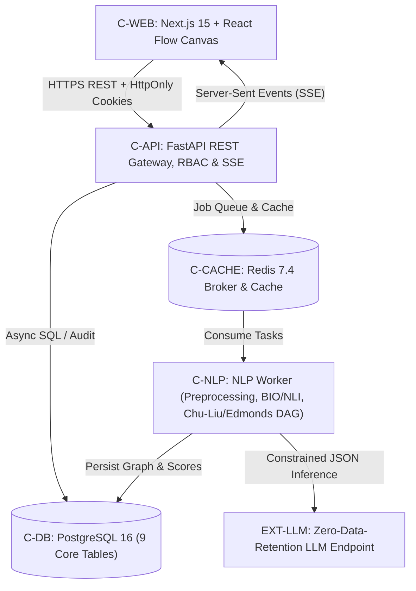

<div align="center">

<h1>ARGUMIND</h1>

<h3>Explainable Argumentative Writing Analytics, Directed Acyclic Graph (DAG) Reasoning &amp; Critical Thinking Assessment Platform</h3>

<p>Engineered with Hybrid IndoBERT + Cross-Encoder NLI, Chu-Liu/Edmonds Arborescence Decoding &amp; Graph-Grounded Rubric Evaluation</p>

<p>
  
  
  
  
  <br />
  
</p>

<p>
  
  
  
  
  
  <br />
  
</p>

<hr />

<p>
  <a href="#1-ringkasan-eksekutif">Ringkasan Eksekutif</a> •
  <a href="#2-kapabilitas-produk">Kapabilitas Produk</a> •
  <a href="#3-arsitektur-dan-tech-stack">Arsitektur Sistem</a> •
  <a href="#4-struktur-monorepo">Struktur Monorepo</a> •
  <a href="#5-instalasi-dan-quick-start">Instalasi &amp; Quick Start</a> •
  <a href="#6-dokumentasi-api">Dokumentasi API</a> •
  <a href="#7-pengujian-dan-kualitas-kode">Pengujian &amp; QA</a> •
  <a href="#8-keamanan-dan-privasi">Keamanan &amp; RBAC</a> •
  <a href="#9-alur-kontribusi-git">Alur Git</a> •
  <a href="#10-indeks-dokumentasi">Indeks Dokumentasi</a>
</p>

<hr />

</div>

## 1. Ringkasan Eksekutif

Peninjauan manual terhadap draf esai analitis, laporan kebijakan, maupun kajian bisnis membutuhkan waktu 15–30 menit per dokumen dan rentan terhadap inkonsistensi antar-penilai. Di sisi lain, umpan balik AI generik yang hanya berupa ringkasan teks bebas sulit diaudit karena tidak menautkan skor ke kalimat sumbernya.

**Argumind Platform** menghadirkan alur kerja *human-in-the-loop* dengan antarmuka **Dual-Pane Workspace**:
- **Panel Teks Beranotasi**: Menyorot rentang karakter (`Claim`, `ExplicitPremise`, `Evidence`) lengkap dengan lencana aksesibilitas non-warna (`[C]`, `[P]`, `[E]`).
- **Kanvas Graf Argumen Interaktif**: Memvisualisasikan relasi berarah (`Support` bergaris solid, `Attack` bergaris putus-putus) dengan sinkronisasi sorotan dua arah ($\le 100\text{ ms}$) antara simpul graf dan teks sumber.
- **Panel Rubrik & Audit Diagnostik**: Menyajikan skor 4 dimensi (`1..5`) yang wajib menyertakan referensi simpul/celah (`grounded_refs`), didukung alur koreksi manual penilai (*human override* beraudit).

---

## 2. Kapabilitas Produk

Cakupan fitur (`F-01` – `F-07`) dan status implementasi mengacu langsung pada pelacak progres di [`docs/PROGRESS.md`](docs/PROGRESS.md).

| ID | Fitur | Deskripsi Fungsional | Status Saat Ini |
|---|---|---|---|
| **`F-01`** | **Ingesti Dokumen & Ekstraksi Komponen** | Unggah teks/berkas (`.txt`, `.md`, `.docx`, `.pdf`), validasi batas `300–2.500` kata, normalisasi NFKC, redaksi PII otomatis (`[REDACTED_NAME]`, `[REDACTED_ID]`, `[REDACTED_EMAIL]`), dan ekstraksi span `Claim`, `ExplicitPremise`, `Evidence`. | `Done` (Fase 1) |
| **`F-02`** | **Pemetaan Relasi & Kanvas Graf DAG** | Klasifikasi relasi `Support` / `Attack`, dekode *Chu-Liu/Edmonds maximum spanning arborescence* untuk menjamin sub-graf `Support` bebas siklus (`self-loop == 0`), serta visualisasi interaktif berbasis `@xyflow/react`. | `Done` (Fase 1) |
| **`F-03`** | **Deteksi Premis Implisit & Celah Penalaran** | Rekonstruksi jembatan logis (`ImplicitPremise`) dan deteksi 6 kategori `ReasoningGap` (`UnsupportedClaim`, `HastyGeneralization`, `FalseCause`, `CircularReasoning`, `MissingCounterargumentConsideration`, `WeakEvidence`). | `In Progress` (Stub deterministik aktif; integrasi `EXT-LLM` di Fase 2) |
| **`F-04`** | **Penilaian Rubrik 4 Dimensi Terjelaskan** | Evaluasi `ClarityOfClaim`, `PremiseSupportAndCoherence`, `EvidenceAdequacy`, `CounterargumentAndLimitationAwareness` (skala `1..5`) dengan wajib `grounded_refs` serta *human override* penilai. | `In Progress` (API & panel rubrik dasar aktif) |
| **`F-05`** | **Generator Kontraargumen Terarah** | Pembangkitan 1–3 kontraargumen yang menarget simpul `Claim` atau `ImplicitPremise` spesifik sebagai bahan uji ketahanan argumen penulis. | `Planned` (Fase 2; dukungan skema & stub awal tersedia) |
| **`F-06`** | **Ruang Kerja Anotasi Ganda & Adjudikasi** | Mode anotasi *double-blind* untuk tim penilai/kurator disertai kalkulator kesepakatan otomatis (*Krippendorff's alpha* & *Quadratic Weighted Kappa*) dan konsol resolusi konsensus (*gold standard*). | `Done` (Fase 1) |
| **`F-07`** | **Komparasi Revisi & Ekspor Laporan** | Perbandingan selisih celah logika dan skor antar-versi draf serta ekspor terstruktur (`.json` / `.pdf`). | `Planned` (Fase 3) |

---

## 3. Arsitektur dan Tech Stack

### Topologi Layanan



### Tumpukan Teknologi (*Tech Stack*)

| Lapisan | Teknologi & Paket Utama | Peran Teknis |
|---|---|---|
| **Web Frontend (`apps/web`)** | Next.js `15.1.x` (App Router), React `19.0.x`, TypeScript `5.7.x`, Tailwind CSS `4.0.x`, `@xyflow/react ^12.3.6`, `elkjs ^0.9.3`, `zustand ^5.0.0`, `@tanstack/react-query ^5.60.0`, `zod ^3.23.8` | Antarmuka Dual-Pane Workspace, kanvas graf interaktif, state klien berfrekuensi tinggi, validasi kontrak UI. |
| **Core API (`apps/api`)** | Python `>= 3.12` (terverifikasi pada `3.13.5`), FastAPI `>= 0.115.0`, Pydantic `>= 2.10.0`, SQLAlchemy `>= 2.0.35` (Async) + Alembic `>= 1.14.0`, PyJWT + Cryptography, Structlog | REST API & SSE, autentikasi `RS256` JWT Cookie + `TOTP` MFA, RBAC scope `OWN`/`ORG`/`BLIND`, standar error `RFC 9457`. |
| **NLP & Graph Worker (`apps/nlp-worker`)** | NetworkX `>= 3.4.0`, NumPy `>= 2.1.0`, Scikit-learn `>= 1.5.2`, PyMuPDF `>= 1.24.0`, `python-docx >= 1.1.2`, PyTorch `>= 2.5.0`, Transformers `>= 4.46.0` | Parser dokumen, prapemrosesan 6 tahap + redaksi PII, dekoder Chu-Liu/Edmonds DAG, modul evaluasi terikat graf. |
| **Shared Packages (`packages/*`)** | Pydantic v2, Zod, NumPy | Kontrak skema lintas-bahasa (`shared-schemas`) dan mesin kalkulasi reliabilitas/kesepakatan penilai (`evaluation-metrics`). |
| **Infrastruktur (`infra/*`)** | PostgreSQL `16-alpine`, Redis `7.4-alpine`, Docker Compose | Penyimpanan relasional 9 entitas terindeks (`B-Tree` & `GIN`), antrean tugas asinkron, *rate limiting*, dan cache. |

---

## 4. Struktur Monorepo

```text
argumind-platform/
├── apps/
│   ├── web/                          # Aplikasi frontend Next.js (App Router)
│   │   ├── src/app/                  # Halaman: /login, /dashboard, workspace, annotations, adjudicate, /forbidden
│   │   ├── src/components/           # AnnotatedTextPane, ArgumentGraphCanvas, RubricPanel, UploadDocumentModal
│   │   ├── src/hooks/                # useArgumentStream (konsumsi SSE progresif)
│   │   ├── src/lib/                  # apiClient (fetch + cookie credentials + CSRF)
│   │   ├── src/stores/               # workspaceStore (Zustand state sinkronisasi teks-graf)
│   │   └── src/styles/tokens.css     # Design tokens CSS (kontras WCAG 2.1 AA)
│   ├── api/                          # Layanan Core REST API & SSE (FastAPI)
│   │   ├── src/argumind_api/auth/    # security.py (scrypt, RS256, TOTP), dependencies.py, policies.py
│   │   ├── src/argumind_api/routers/ # auth_router.py, documents_router.py, runs_router.py
│   │   ├── src/argumind_api/         # main.py, store.py, errors.py (RFC 9457 Problem Details)
│   │   └── tests/                    # test_api.py (integrasi RBAC, scope BLIND, MFA, SSE, adjudikasi)
│   └── nlp-worker/                   # Worker pemrosesan teks & graf argumen
│       ├── src/argumind_nlp/         # preprocessing.py, dag_decoder.py, reasoning.py
│       └── tests/unit/               # test_nlp_pipeline.py
├── packages/
│   ├── shared-schemas/               # Kontrak skema bersama Pydantic v2 (src/argumind_schemas/) & Zod (src/index.ts)
│   └── evaluation-metrics/           # Kalkulasi Macro-F1, QWK, Krippendorff alpha, Spearman, FaithfulnessRate
├── infra/
│   ├── docker/docker-compose.yml     # Layanan lokal PostgreSQL 16 & Redis 7.4 dengan healthcheck
│   └── migrations/001_initial_schema.sql # Skema SQL 9 tabel inti, enum, constraint, & indeks B-Tree/GIN
├── docs/                             # Spesifikasi produk, arsitektur, skema DB, desain UI, QA, & alur Git
├── AGENTS.md                         # Panduan operasional monorepo & peta pembacaan dokumen
├── package.json                      # Skrip workspace root PNPM
└── pnpm-workspace.yaml               # Konfigurasi paket workspace Node.js
```

---

## 5. Instalasi dan Quick Start

### Prasyarat Lingkungan

- **Python**: `>= 3.12` dan [`uv`](https://docs.astral.sh/uv/) (atau `pip`)
- **Node.js**: `22 LTS` + `corepack` (`pnpm`) atau `npm`
- **Docker & Docker Compose**: Untuk menjalankan `PostgreSQL 16` dan `Redis 7.4`

### 1. Menyalakan Infrastruktur Data (`PostgreSQL 16` & `Redis 7.4`)

Dari direktori `argumind-platform/`:

```bash
docker compose -f infra/docker/docker-compose.yml up -d
```

Skrip inisialisasi [`infra/migrations/001_initial_schema.sql`](infra/migrations/001_initial_schema.sql) secara otomatis membuat 9 tabel inti (`organizations`, `users`, `documents`, `document_versions`, `analysis_runs`, `argument_nodes`, `argument_edges`, `reasoning_gaps`, `rubric_scores`) beserta seluruh *constraint* dan indeks saat volume `pgdata` pertama kali dibuat.

### 2. Menyiapkan Backend & NLP Environment (Python `.venv`)

Dari direktori root repositori (`../` relatif terhadap `argumind-platform/`):

```bash
# Membuat dan mengisi virtual environment dari pyproject.toml
uv venv .venv
uv pip install --python .venv -e ".[dev]"
```

> **Catatan Windows (Partisi Tanpa Dukungan Symlink/Hardlink):** Jika repositori berada di partisi yang menolak *hardlink* atau *symlink* (`os error 1`), tambahkan flag `--link-mode=copy` saat menjalankan `uv pip install`, serta pastikan `argumind_workspace.pth` pada `site-packages` mengarahkan interpreter ke seluruh direktori `src` di monorepo.

Jalankan server pengembangan **Core API**:

```bash
# Windows PowerShell
.venv\Scripts\python.exe -m uvicorn argumind_api.main:app --reload --port 8000

# Linux / macOS
.venv/bin/python -m uvicorn argumind_api.main:app --reload --port 8000
```

Verifikasi kesehatan layanan di `http://localhost:8000/health` (`{"status": "ok"}`) atau dokumentasi interaktif OpenAPI di `http://localhost:8000/docs`.

### 3. Menyiapkan Frontend Web (`apps/web`)

Salin contoh konfigurasi environment dan jalankan server Next.js:

```bash
cp apps/web/.env.example apps/web/.env.local
pnpm install --frozen-lockfile
pnpm --filter web dev
```

Aplikasi web dapat diakses melalui `http://localhost:3000`.

> **Catatan Windows Tanpa Dukungan Symlink:** `pnpm` memerlukan pembuatan *symlink* workspace untuk paket internal (`@argumind/shared-schemas`). Pada partisi Windows yang menonaktifkan pembuatan *symlink* bagi pengguna non-administrator (`os error 1`), jalankan instalasi langsung di dalam `apps/web/` menggunakan `npm install --no-bin-links`.

---

## 6. Dokumentasi API

Ringkasan kontrak endpoint `/api/v1` yang diimplementasikan oleh Core API (`apps/api`).

| Kelompok | Method & Path | Fungsi Utama |
|---|---|---|
| **Health** | `GET /health` | Pemeriksaan status layanan API |
| **Autentikasi** | `POST /api/v1/auth/login` | Login email/kata sandi (`scrypt`) + opsional kode `TOTP`, menerbitkan cookie `HttpOnly` JWT `RS256` |
| | `POST /api/v1/auth/mfa/verify` | Verifikasi tantangan MFA (`TOTP` RFC 6238) untuk peran berhak istimewa |
| | `POST /api/v1/auth/refresh` | Rotasi *refresh token* dengan deteksi pemakaian ulang (*reuse detection*) |
| | `POST /api/v1/auth/logout` \| `GET /api/v1/auth/me` | Pencabutan sesi/cookie & profil sesi aktif |
| **Dokumen & Analisis** | `POST /api/v1/documents` \| `GET /api/v1/documents` | Ingesti teks/berkas (`.txt`, `.md`, `.docx`, `.pdf`), redaksi PII, validasi `300..2500` kata |
| | `POST /api/v1/documents/{doc_id}/versions/{ver}/analyze` | Memicu pipeline analisis argumen asinkron (`HTTP 202` + `job_id`) |
| | `GET /api/v1/jobs/{job_id}/stream` | Streaming progres analisis bertahap via *Server-Sent Events* (`SSE`) |
| **Graf, Rubrik & Kalibrasi** | `GET /api/v1/runs` \| `GET /api/v1/runs/{run_id}` | Mengambil daftar & detail node graf, relasi, celah logika, dan skor rubrik sesuai scope peran |
| | `PATCH /api/v1/runs/{run_id}/nodes/{node_key}/feedback` | Menyimpan umpan balik `ACCEPTED` / `REJECTED` pada premis implisit & kontraargumen |
| | `PATCH /api/v1/runs/{run_id}/scores/{dimension}` | Koreksi skor manusia (*human override*) dengan alasan tertulis oleh `reviewer` |
| | `PUT /api/v1/annotations/{doc_ver_id}` | Menyimpan anotasi independen pada mode *double-blind* |
| | `POST /api/v1/annotations/{doc_ver_id}/adjudicate` | Mengkalkulasi $\alpha_{\text{Krip}}$ & `QWK` lalu mengunci konsensus final (`gold_adjudicated`) |

---

## 7. Pengujian dan Kualitas Kode

Seluruh aturan verifikasi mengikuti [`docs/TESTING.md`](docs/TESTING.md) dan [`docs/CODE_STYLE.md`](docs/CODE_STYLE.md).

### Perintah Verifikasi Utama

| Tugas | Perintah | Ruang Lingkup |
|---|---|---|
| **Lint Python** | `ruff check argumind-platform && ruff format --check argumind-platform` | Gaya kode & keamanan statis (`E`, `F`, `I`, `B`, `UP`, `S`, `ASYNC`) |
| **Typecheck Python** | `mypy argumind-platform/apps argumind-platform/packages` | Pengecekan tipe ketat (`strict = true`, Pydantic & SQLAlchemy plugin) |
| **Test & Coverage Backend/NLP/Packages** | `pytest -v --cov=argumind_schemas --cov=argumind_metrics --cov=argumind_nlp --cov=argumind_api --cov-report=term-missing` | Seluruh unit test & integrasi API/RBAC (`17/17 passed`, `92%` coverage total) |
| **Lint & Typecheck Web** | `pnpm --filter web lint && pnpm --filter web typecheck` | ESLint 9 & `tsc --noEmit` |
| **Build Produksi Web** | `pnpm --filter web build` | Validasi bundle produksi Next.js |

### Target Ambang Cakupan Kode (`docs/TESTING.md`)

| Paket / Lapisan | Target Line Coverage | Target Branch Coverage |
|---|---|---|
| `packages/*` (`shared-schemas`, `evaluation-metrics`) | $\ge 95.0\%$ | $\ge 90.0\%$ |
| `apps/api` (Core API & RBAC Policies) | $\ge 85.0\%$ | $\ge 80.0\%$ |
| `apps/nlp-worker` (Preprocessing, DAG & Reasoning) | $\ge 85.0\%$ | $\ge 80.0\%$ |
| `apps/web` (Komponen UI & Workspace Stores) | $\ge 80.0\%$ | $\ge 75.0\%$ |

---

## 8. Keamanan dan Privasi

- **Autentikasi & Perlindungan Sesi**: Token akses JWT bertanda tangan asimetris **`RS256`** (`TTL = 15 menit`) disimpan eksklusif dalam cookie `HttpOnly` (bukan `localStorage`) disertai proteksi header CSRF untuk permintaan mutasi, kata sandi di-hash menggunakan `scrypt` + *random 16-byte salt* (dengan target migrasi `Argon2id` tercantum pada spesifikasi), serta verifikasi **`TOTP` (RFC 6238)**.
- **Kontrol Akses Berbasis Peran & Scope Server (`ROLES_PERMISSIONS.md`)**:
  - `author` — Scope `OWN`: mengunggah draf dan melihat hasil analisis milik sendiri.
  - `reviewer` — Scope `ORG`: meninjau dokumen organisasi, memberi *human override* skor rubrik, dan memimpin konsensus adjudikasi.
  - `annotator` — Scope `BLIND`: melakukan pelabelan independen tanpa akses ke hasil model AI maupun hasil anotator lain pada dokumen yang sama.
  - `org_admin` — Scope `ORG`: mengelola anggota, kuota dokumen bulanan, dan konfigurasi organisasi.
- **Redaksi PII Otomatis**: Header nama, NIM/ID, nomor telepon (`+62`/`08...`), dan email disamarkan otomatis sebelum masuk ke penyimpanan teks bersih maupun pemrosesan model.
- **Standar Respons Error (`RFC 9457`)**: Seluruh penolakan domain, validasi skema, dan otorisasi mengembalikan `application/problem+json` lengkap dengan kode error terstruktur (`type`, `title`, `status`, `code`, `detail`, `trace_id`).

---

## 9. Alur Kontribusi Git

Aturan kontribusi pengembang dan agen otomasi diatur pada [`docs/GIT_WORKFLOW.md`](docs/GIT_WORKFLOW.md) dan [`AGENTS.md`](AGENTS.md):
- **Branching**: Dilarang melakukan push langsung ke `main`. Gunakan branch terpisah berpola `<feat|fix|docs|chore>/<id>-<slug>` (atau `ai/<tipe>/<id>-<slug>` untuk perubahan berbantuan AI).
- **Conventional Commits**: `<type>(<scope>): <deskripsi singkat>` (contoh: `feat(nlp): implement chu-liu edmonds dag decoder`).
- **Definition of Done (DoD)**: Setiap fitur dan perbaikan bug wajib lulus 8 gerbang berurutan: lint bersih, typecheck ketat, build produksi, seluruh test & cakupan lulus, responsivitas `375px`/`768px`/`1440px`, audit aksesibilitas WCAG 2.1 AA, verifikasi state loading/error, serta pembaruan [`docs/PROGRESS.md`](docs/PROGRESS.md).

---

## 10. Indeks Dokumentasi

| Dokumen | Fokus Bahasan |
|---|---|
| [`AGENTS.md`](AGENTS.md) | Peta kerja agen AI, perintah standar monorepo, aturan wajib, dan larangan keras |
| [`docs/PRD.md`](docs/PRD.md) | Kebutuhan produk, metrik keberhasilan produk (`M-01`–`M-05`), persona, dan spesifikasi `F-01`–`F-07` |
| [`docs/ARCHITECTURE.md`](docs/ARCHITECTURE.md) | Diagram komponen sistem, daftar library resmi, alur data REST/SSE, dan anggaran performa |
| [`docs/DATA_MODEL.md`](docs/DATA_MODEL.md) | Skema PostgreSQL 9 tabel, aturan integritas graf/span, dan kontrak endpoint API |
| [`docs/ROLES_PERMISSIONS.md`](docs/ROLES_PERMISSIONS.md) | Matriks izin CRUD per peran, isolasi `OWN`/`ORG`/`BLIND`, autentikasi, dan log audit |
| [`docs/DESIGN_SYSTEM.md`](docs/DESIGN_SYSTEM.md) | Token warna, tipografi, aturan aksesibilitas graf, dan sistem komponen UI |
| [`docs/PAGES_AND_FLOWS.md`](docs/PAGES_AND_FLOWS.md) | Peta rute halaman (`P-01`–`P-07`), alur utama pengguna, dan seluruh state UI |
| [`docs/CODE_STYLE.md`](docs/CODE_STYLE.md) | Konvensi penamaan Python/TypeScript, konfigurasi `ruff`/`mypy`/`eslint`, dan standar logging |
| [`docs/TESTING.md`](docs/TESTING.md) | Strategi unit/integrasi/E2E/beban, target coverage, dan checklist 8 langkah *Definition of Done* |
| [`docs/GIT_WORKFLOW.md`](docs/GIT_WORKFLOW.md) | Strategi branching, *Conventional Commits*, syarat merge PR, dan rilis SemVer |
| [`docs/DECISIONS.md`](docs/DECISIONS.md) | Catatan Keputusan Arsitektur (*Architecture Decision Records* / ADR) |
| [`docs/PROGRESS.md`](docs/PROGRESS.md) | Pelacak fase rilis aktif, daftar blocker, dan log aktivitas terkini |
