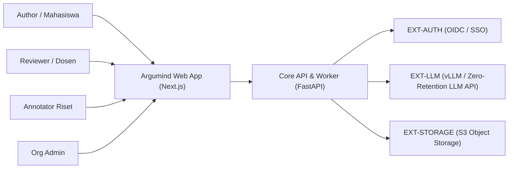
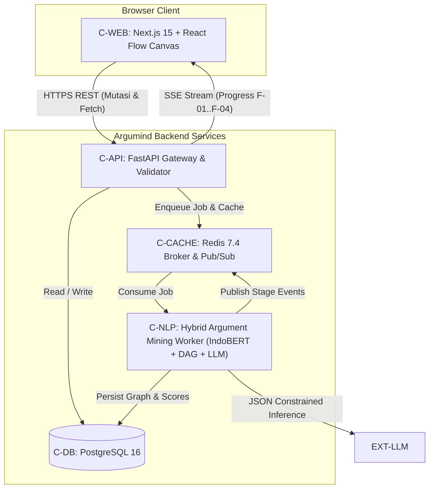

Tujuan: Menetapkan arsitektur teknis, komponen sistem, tumpukan teknologi, struktur direktori, alur data, autentikasi, penanganan error, dan konfigurasi environment untuk platform Argumind.
Status dan tanggal: Draft v1.0 | 2026-11-18
Sumber kebenaran untuk: Topologi komponen (`C-WEB`, `C-API`, `C-NLP`, `C-DB`, `C-CACHE`), daftar library resmi, pohon direktori monorepo, dan anggaran performa teknis.

# Arsitektur Sistem (System Architecture): Argumind Platform

> **Catatan Keputusan Arsitektur (`ADR-01` s.d. `ADR-04`):** Pemilihan tumpukan teknologi dan versi di bawah ini berstatus `ASUMSI: tumpukan standar web + AI Python` yang dicatat pada `→ docs/DECISIONS.md` dan menunggu pengesahan arsitek utama pada bagian Pertanyaan Terbuka. Detail skema tabel dan graf dirujuk ke `→ docs/DATA_MODEL.md`.

---

## 1. Konteks Sistem: Aktor dan Sistem Eksternal

### A. Aktor Pengguna
Definisi peran dan matriks izin merujuk ke `→ docs/PRD.md#3-persona-pengguna` dan `→ docs/ROLES_PERMISSIONS.md`:
1. **`author` (Penulis / Mahasiswa):** Mengunggah draf, meninjau peta graf argumen (`F-01`–`F-03`), melihat skor diagnostik (`F-04`), dan memicu kontraargumen (`F-05`).
2. **`reviewer` (Penilai / Dosen / Analis Senior):** Meninjau bukti span teks, memvalidasi skor rubrik 4 dimensi, dan memberikan `human_override_score` (`F-04`, `F-07`).
3. **`annotator` (Anotator Riset):** Melakukan anotasi *double-blind* dan adjudikasi korpus (`F-06`).
4. **`org_admin` (Admin Institusi):** Mengelola kuota organisasi, anggota, dan konfigurasi rubrik.

### B. Sistem Eksternal
1. **`EXT-LLM` (Penyedia Inferensi LLM Zero-Retention / vLLM Self-Hosted):** Menjalankan inferensi JSON terikat untuk rekonstruksi `ImplicitPremise`, klasifikasi `ReasoningGap` (`F-03`), evaluasi rubrik (`F-04`), dan `Counterargument` (`F-05`). WAJIB mengaktifkan kebijakan *zero data retention*.
2. **`EXT-AUTH` (Penyedia Identitas OIDC / SAML Kampus):** Layanan SSO opsional (Google Workspace Education / Microsoft Entra ID) untuk autentikasi institusi.
3. **`EXT-STORAGE` (S3-Compatible Object Storage):** Penyimpanan terenkripsi (`AES-256`) untuk berkas mentah `.docx`/`.pdf` dan hasil ekspor laporan `.pdf`/`.json` (`F-01`, `F-07`).



---

## 2. Komponen Sistem dan Diagram Komponen

*Seluruh versi teknologi di bawah ini menggunakan `ASUMSI: versi LTS/stabil terkini` (`TODO(Q-ARCH-01)`).*

| ID & Nama Komponen | Tanggung Jawab Utama | Teknologi dan Versi (`ASUMSI`) | Berkomunikasi Dengan |
|---|---|---|---|
| **`C-WEB`**<br>Web Frontend SPA/SSR | Merender editor dokumen, kanvas graf interaktif (`F-02`), ruang anotasi (`F-06`), dan laporan diagnostik (`F-04`, `F-07`). | Next.js `15.x` (App Router), React `19.x`, TypeScript `5.7.x`, Tailwind CSS `4.x` | `C-API` via `HTTPS REST` + `Server-Sent Events (SSE)` |
| **`C-API`**<br>Core Backend API | Mengelola autentikasi, otorisasi RBAC, parser dokumen (`.docx`/`.pdf`), orkestrasi tugas analisis, validasi skema `grounded_refs`, dan ekspor laporan. | Python `3.12.x`, FastAPI `0.115.x`, Pydantic `2.10.x`, Uvicorn | `C-WEB`, `C-DB`, `C-CACHE`, `C-NLP`, `EXT-STORAGE`, `EXT-AUTH` |
| **`C-NLP`**<br>Hybrid NLP & Argument Worker | Menjalankan *pipeline* pra-pemrosesan 6 tahap, segmentasi `IndoBERT + BiLSTM-CRF` (`F-01`), klasifikasi NLI + dekode *Minimum Spanning DAG* (`F-02`), serta orkestrasi prompt LLM (`F-03`–`F-05`). | Python `3.12.x`, PyTorch `2.5.x`, Transformers `4.46.x`, Celery `5.4.x` / Arq | `C-CACHE` (antrean tugas), `C-DB`, `EXT-LLM` |
| **`C-DB`**<br>Primary Relational Store | Menyimpan pengguna, dokumen, versi draf, node/edge graf argumen, anotasi *double-blind*, dan log audit penilaian (`→ docs/DATA_MODEL.md`). | PostgreSQL `16.x` | `C-API`, `C-NLP` via `asyncpg` (TCP `5432`) |
| **`C-CACHE`**<br>Task Broker & Cache | Mengantrekan pekerjaan analisis asinkron, menyiarkan progres `SSE` bertahap (`F-01` $\rightarrow$ `F-04`), melakukan *rate limiting*, dan *caching* hasil NLI/graf. | Redis `7.4.x` | `C-API`, `C-NLP` via TCP `6379` |



---

## 3. Pohon Folder Monorepo

```text
argumind-platform/
├── apps/
│   ├── web/                    # Aplikasi frontend Next.js (App Router, halaman, komponen UI, kanvas graf)
│   ├── api/                    # Layanan REST API & SSE FastAPI (endpoint, middleware auth, validasi skema)
│   └── nlp-worker/             # Worker komputasi AI (pra-pemrosesan, IndoBERT/NLI lokal, dekode DAG, klien LLM)
├── packages/
│   ├── shared-schemas/         # Kontrak JSON Schema & tipe bersama (OpenAPI generator untuk TypeScript & Pydantic)
│   └── evaluation-metrics/     # Modul perhitungan metrik riset (Macro-F1, QWK, Krippendorff alpha, FaithfulnessRate)
├── infra/
│   ├── docker/                 # Dockerfile multi-stage dan docker-compose untuk pengembangan & produksi
│   └── migrations/             # Skrip migrasi skema database Alembic (merujuk ke docs/DATA_MODEL.md)
├── docs/                       # Dokumentasi spesifikasi produk, arsitektur, model data, dan aturan penulisan
└── tests/                      # Pengujian integrasi lintas layanan dan E2E Playwright (merujuk ke docs/TESTING.md)
```

---

## 4. Daftar Library Utama dan Alternatif yang Ditolak

*Seluruh versi menggunakan `ASUMSI: versi terkunci pada package.json / pyproject.toml`.*

| Nama Library | Versi (`ASUMSI`) | Alasan Pemilihan | Alternatif yang Ditolak & Alasan Penolakan |
|---|---|---|---|
| `@xyflow/react` (React Flow) | `^12.3.x` | Mendukung node HTML kustom (badge komponen, tombol aksi), tata letak DAG interaktif $\ge 55\text{ fps}$ untuk $\le 100$ node, dan aksesibilitas keyboard. | `Cytoscape.js` / `D3-force`: Sulit merender kartu React kompleks dengan interaksi form di dalam node; *force layout* acak menyulitkan pembacaan hierarki argumen. |
| `dagre` / `elkjs` | `^0.9.x` (elkjs) | Menghitung posisi tata letak hierarkis berarah (*layered DAG layout*) secara deterministik untuk pohon `Premise → Claim`. | Penataan koordinat manual: Menghasilkan garis edge bersilangan pada dokumen dengan $> 15$ komponen. |
| `@tanstack/react-query` | `^5.60.x` | Mengelola *server state*, invalidasi cache otomatis, *optimistic update* saat anotator memberi label, dan sinkronisasi dengan aliran `SSE`. | `Redux Toolkit`: Terlalu banyak *boilerplate* untuk sinkronisasi *server state* dan manajemen cache REST. |
| `zustand` | `^5.0.x` | Mengelola *client UI state* berfrekuensi tinggi (koordinat kanvas, `active_node_id`, sorotan dua arah teks-graf $\le 100\text{ ms}$) tanpa me-render ulang pohon komponen. | `React Context API`: Memicu *re-render* seluruh halaman saat pengguna menggeser node atau menyorot span karakter. |
| `zod` (Web) & `pydantic` (API) | `^3.23.x` / `^2.10.x` | Validasi kontrak ketat untuk memastikan `start_char < end_char`, `source_id != target_id`, dan `grounded_refs` tidak kosong pada `F-04`. | Validasi manual berbasis `if/else`: Rentan melewatkan kasus batas skema JSON dari output LLM. |
| `SQLAlchemy` (Async) + `Alembic` | `^2.0.x` / `^1.14.x` | ORM asinkron matang di ekosistem Python dengan dukungan tipe `JSONB` PostgreSQL dan migrasi skema terversi. | `Prisma Python`: Dukungan komunitas Python kurang matang dibandingkan ekosistem asli TypeScript. |
| `PyMuPDF` (`fitz`) & `python-docx` | `^1.24.x` / `^1.1.x` | Ekstraksi teks `.pdf` dan `.docx` deterministik yang mempertahankan urutan paragraf dengan latensi $< 200\text{ ms}$ per dokumen. | `pdfminer.six`: Jauh lebih lambat (3–5x) pada dokumen multi-halaman. |
| `NetworkX` | `^3.4.x` | Eksekusi algoritma *Minimum Spanning Arborescence* (Chu-Liu/Edmonds) untuk memutus siklus pada graf relasi argumen (`F-02`). | Implementasi algoritma graf kustom: Risiko bug pada penanganan komponen terhubung kuat (*strongly connected components*). |

---

## 5. Alur Data per Jalur

### A. Jalur Fetch (Pembacaan Dokumen, Graf, dan Skor)
1. Klien (`C-WEB`) memanggil `GET /api/v1/documents/{doc_id}/analysis` dengan header kredensial.
2. `C-API` memeriksa cache `C-CACHE` menggunakan kunci `analysis:{doc_id}:{version_id}`. Jika *cache hit*, kembalikan payload JSON dalam $\le 30\text{ ms}$.
3. Jika *cache miss*, `C-API` mengambil data dari `C-DB`, menyusun respons tervalidasi `Pydantic`, menyimpan ke `C-CACHE` (`TTL = 3600 detik`), dan mengirim `HTTP 200` ke `C-WEB`.
4. *Contoh kunci cache:* `analysis:doc_01JCY9:v2` $\rightarrow$ menyimpan objek graf dan `RubricScore`.

### B. Jalur Mutasi & Analisis Bertahap (*Progressive Pipeline* `F-01`–`F-04`)
1. Klien mengirim `POST /api/v1/documents/{doc_id}/analyze` (`HTTP 202 Accepted` dikembalikan dalam $\le 150\text{ ms}$ beserta `job_id`).
2. `C-API` mendorong tugas ke antrean `C-CACHE`, lalu klien membuka koneksi `GET /api/v1/jobs/{job_id}/stream` (`text/event-stream`).
3. `C-NLP` mengeksekusi pipeline dan mempublikasikan 3 event `SSE` berurutan agar memenuhi target *progressive rendering* (`→ docs/PRD.md#7-asumsi-risiko-dan-fase-rilis`):
   - `event: stage_1_structure` ($\le 4.0\text{ detik}$): Mengirim hasil `F-01` (`ArgumentNode` eksplisit) dan `F-02` (`ArgumentEdge` DAG) agar kanvas graf langsung tampil.
   - `event: stage_2_implicit_gaps` ($\le 10.0\text{ detik}$): Mengirim hasil `F-03` (`ImplicitPremise` dan `ReasoningGap`).
   - `event: stage_3_scoring_complete` ($\le 15.0\text{ detik}$): Mengirim hasil `F-04` (`RubricScore` tervalidasi `grounded_refs`) dan menutup stream.
4. Untuk mutasi sinkron (koreksi manual `reviewer` pada `F-04` atau simpan anotasi `F-06`), klien mengirim `PATCH` / `PUT`; `C-API` menulis ke `C-DB` dalam transaksi atomik dan menghapus kunci `analysis:{doc_id}:*` di `C-CACHE`.

### C. State Management dan Strategi Caching
- **Server State (`TanStack Query`):** `staleTime = 60_000 ms` (`1 menit`) untuk daftar dokumen dan hasil analisis yang sudah berstatus `COMPLETED`; `staleTime = 0` untuk sesi adjudikasi anotasi aktif (`F-06`).
- **Client UI State (`Zustand`):** Menyimpan `{ selectedNodeId, hoveredSpanRange, canvasViewport, activeFilterSeverity }`. Saat pengguna mengklik node `N-01`, store memperbarui `selectedNodeId = "N-01"` dan memicu `scrollIntoView` pada elemen teks `[data-node-id="N-01"]` dalam $\le 100\text{ ms}$.
- **Deduplikasi Hash Konten (Backend Cache):** `C-NLP` menghitung hash `SHA-256` dari teks bersih pasca-Tahap 2 pra-pemrosesan. Jika teks identik pernah dianalisis dengan versi model yang sama, hasil diekstrak dari cache `model_out:{sha256}:{model_ver}` (`TTL = 86400 detik`) tanpa memanggil ulang `EXT-LLM`.

---

## 6. Autentikasi dan Penanganan Error

Matriks hak akses per endpoint dan aturan isolasi data (*blind annotation*) diatur sepenuhnya di `→ docs/ROLES_PERMISSIONS.md`.

### A. Mekanisme Autentikasi
- Menggunakan **JWT (`RS256`)** yang disimpan di dalam cookie `HttpOnly; Secure; SameSite=Lax` (`access_token` `TTL = 15 menit`, `refresh_token` `TTL = 7 hari` dengan rotasi di `C-CACHE`).
- JANGAN menyimpan token autentikasi di `localStorage` atau `sessionStorage` untuk mencegah pencurian via XSS.
- Setiap permintaan mutasi (`POST`, `PUT`, `PATCH`, `DELETE`) WAJIB memvalidasi token CSRF (`X-CSRF-Token`) dan klaim peran (`role: author | reviewer | annotator | org_admin`).

### B. Standar Penanganan Error (`RFC 9457 Problem Details`)
Seluruh respons error dari `C-API` WAJIB menggunakan format JSON terstandar dengan kode status HTTP eksplisit:

| Kode HTTP | Kode Error Aplikasi | Kondisi Pemicu | Perilaku Penanganan |
|---|---|---|---|
| `400 Bad Request` | `ERR_CORRUPT_FILE` | Berkas `.pdf`/`.docx` rusak atau merupakan gambar pindaian tanpa teks. | Tolak unggahan; minta pengguna mengunggah berkas berbasis teks. |
| `401 Unauthorized` | `ERR_AUTH_EXPIRED` | Token JWT kedaluwarsa atau tidak valid. | Klien otomatis memanggil `/api/v1/auth/refresh` 1 kali; jika gagal, arahkan ke halaman login. |
| `403 Forbidden` | `ERR_ROLE_FORBIDDEN` | Peran tidak memiliki izin (mis. `author` mengakses panel adjudikasi `F-06` atau melihat anotasi *blind* rekan). | Catat pelanggaran di log audit; tampilkan pemberitahuan akses ditolak. |
| `422 Unprocessable Entity` | `ERR_WORD_COUNT_BOUNDS` | Jumlah kata dokumen `< 300` atau `> 2.500` kata (`F-01`). | Tampilkan jumlah kata aktual pengguna dan batas wajib `300–2.500` kata. |
| `422 Unprocessable Entity` | `ERR_UNFAITHFUL_SCORE` | Output LLM pada `F-04` tidak menyertakan `grounded_refs` yang valid di graf. | `C-NLP` melakukan *automatic retry* (maks `2x`) dengan *prompt* koreksi skema; jika tetap gagal, tandai status `SCORING_VALIDATION_FAILED`. |
| `429 Too Many Requests` | `ERR_RATE_LIMIT` | Pengguna melebihi batas kuota analisis per menit/bulan. | Kembalikan header `Retry-After` (detik). |
| `504 Gateway Timeout` | `ERR_LLM_TIMEOUT` | `EXT-LLM` tidak merespons dalam batas `12.0 detik`. | Tetap simpan dan tampilkan hasil Tahap 1 (`F-01` & `F-02` dari model lokal) serta izinkan *retry* parsial hanya untuk `F-03`/`F-04`. |

*Contoh minimal payload error:*
`{"type": "https://argumind.id/errors/word-count-bounds", "title": "Out of Word Count Bounds", "status": 422, "code": "ERR_WORD_COUNT_BOUNDS", "detail": "Dokumen memiliki 215 kata. Batas wajib adalah 300 hingga 2500 kata.", "trace_id": "req_01JCZ89"}`

---

## 7. Konfigurasi Environment dan Variabel Lingkungan

### A. Spesifikasi Environment

| Environment | Tujuan Penggunaan | Infrastruktur & Isolasi Data |
|---|---|---|
| **`dev`** | Pengembangan fitur lokal dan pengujian unit/integrasi pengembang. | Docker Compose lokal (`PostgreSQL 16`, `Redis 7.4`); memakai data sintetis dan *mock* LLM atau model lokal ringan. |
| **`staging`** | Uji penerimaan pengguna (UAT), kalibrasi anotator, dan uji beban pra-rilis. | Klaster container terisolasi; terhubung ke *checkpoint* model kandidat; memakai korpus publik yang telah dianonimisasi. |
| **`prod`** | Layanan operasional pengguna institusi dan pengumpulan dataset riset resmi (`E-01`–`E-03`). | Container produksi dengan replika aktif, backup `C-DB` harian terenkripsi `AES-256`, `TLS 1.3` wajib, dan *zero data retention* aktif pada `EXT-LLM`. |

### B. Daftar Nama Environment Variable (Tanpa Nilai Rahasia)
JANGAN menyimpan nilai rahasia di repositori Git; seluruh variabel berikut WAJIB diinjeksikan saat *runtime*:

- **Web (`C-WEB`):** `NEXT_PUBLIC_API_BASE_URL`, `NEXT_PUBLIC_APP_ENV`, `NEXT_PUBLIC_SENTRY_DSN`.
- **Core API (`C-API`):** `APP_ENV`, `API_PORT`, `DATABASE_URL`, `REDIS_URL`, `JWT_PRIVATE_KEY_PEM`, `JWT_PUBLIC_KEY_PEM`, `CORS_ALLOWED_ORIGINS`, `S3_ENDPOINT_URL`, `S3_BUCKET_NAME`, `S3_ACCESS_KEY_ID`, `S3_SECRET_ACCESS_KEY`, `OIDC_CLIENT_ID`, `OIDC_CLIENT_SECRET`, `OIDC_ISSUER_URL`.
- **NLP Worker (`C-NLP`):** `REDIS_URL`, `DATABASE_URL`, `INDOBERT_MODEL_PATH`, `NLI_CROSS_ENCODER_PATH`, `LLM_PROVIDER_BASE_URL`, `LLM_API_KEY`, `LLM_MODEL_NAME`, `LLM_TIMEOUT_SECONDS`, `LLM_MAX_RETRIES`, `PII_REDACTION_ENABLED`.

---

## 8. Target Non-Fungsional Terukur (Arsitektur & Frontend)

Melengkapi kebutuhan pada `→ docs/PRD.md#6-kebutuhan-non-fungsional-terukur`, arsitektur WAJIB memenuhi anggaran teknis berikut:

| Metrik Teknis | Ambang Target Eksplisit | Cara Pengukuran & Penegakan CI/CD |
|---|---|---|
| **Largest Contentful Paint (`LCP`)** | $\le 2.0\text{ detik}$ pada koneksi 4G cepat / desktop | Lighthouse CI pada *pipeline* pull request. |
| **Interaction to Next Paint (`INP`)** | $\le 100\text{ ms}$ (termasuk klik node graf $\rightarrow$ sorot teks) | Pengukuran *Performance Observer* & Playwright trace. |
| **Cumulative Layout Shift (`CLS`)** | $\le 0.05$ | Skeleton berukuran tetap saat kanvas graf dan panel skor dimuat. |
| **Ukuran Bundle JS Awal (`C-WEB`)** | $\le 180\text{ KB}$ (gzipped) untuk *initial route*; modul kanvas `@xyflow/react` WAJIB dimuat secara *dynamic import* ($\le 120\text{ KB}$ gzipped). | `next build` bundle analyzer gate; gagal otomatis jika melewati batas. |
| **Latensi Tahap 1 (`F-01` + `F-02` Lokal)** | `p95` $\le 4.0\text{ detik}$ untuk dokumen 1.000 kata pada 1 GPU (mis. NVIDIA T4 / L4). | Benchmark beban `Locust` / `k6` sebelum promosi ke `prod`. |
| **Latensi Pipeline Penuh (`F-01` s.d. `F-04`)** | `p95` $\le 15.0\text{ detik}$ untuk dokumen 1.000 kata. | Metrik histogram Prometheus `argumind_pipeline_duration_seconds`. |

---

## 9. Pertanyaan Terbuka

1. `TODO(Q-ARCH-01 — Pengesahan Tumpukan Teknologi)`: Apakah tumpukan `Next.js 15 (TypeScript)` untuk `C-WEB` dan `FastAPI + PyTorch (Python 3.12)` untuk `C-API`/`C-NLP` disetujui untuk dikunci ke dalam `docs/DECISIONS.md` (`ADR-01`)?
2. `TODO(Q-ARCH-02 — Infrastruktur GPU Worker)`: Apakah layanan `C-NLP` dan `EXT-LLM` pada environment `prod` akan dijalankan pada server GPU *on-premise* kampus/laboratorium atau menggunakan *cloud GPU instance* dengan kontrak *zero data retention*?
