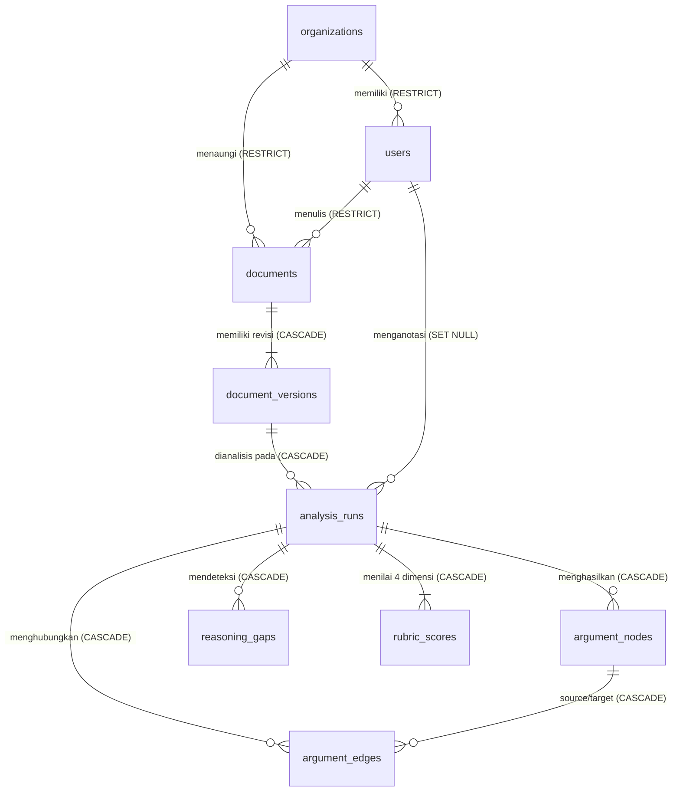

Tujuan: Menetapkan skema database relasional, relasi ERD, definisi enum/status, aturan validasi field, indeks, penandaan PII, kontrak endpoint API, dan aturan anonimisasi data riset untuk platform Argumind.
Status dan tanggal: Draft v1.0 | 2026-11-18
Sumber kebenaran untuk: Skema tabel PostgreSQL (`C-DB`), kontrak payload JSON REST/SSE (`C-API`), tipe node/edge/gap/rubrik, dan skema ekspor korpus riset.

# Model Data & Kontrak API (Data Model): Argumind Platform

---

## 1. Skema Entitas Database (`PostgreSQL 16`)

### 1.1 `organizations` (Institusi / Kampus / Tim Konsultan)
| Field | Tipe | Constraint | Keterangan |
|---|---|---|---|
| `id` | `UUID` | `PK, NOT NULL, DEFAULT gen_random_uuid()` | ID unik institusi. |
| `name` | `VARCHAR(160)` | `NOT NULL` | Nama resmi institusi/organisasi. |
| `slug` | `VARCHAR(80)` | `UNIQUE, NOT NULL` | Pengenal URL unik (`^[a-z0-9-]+$`). |
| `monthly_doc_quota` | `INTEGER` | `NOT NULL, DEFAULT 100, CHECK (>= 0)` | Kuota analisis dokumen per bulan (`→ docs/PRD.md#3-persona-pengguna`). |
| `created_at` | `TIMESTAMPTZ` | `NOT NULL, DEFAULT now()` | Waktu pembuatan. |

### 1.2 `users` (Akun Pengguna)
| Field | Tipe | Constraint | Keterangan |
|---|---|---|---|
| `id` | `UUID` | `PK, NOT NULL, DEFAULT gen_random_uuid()` | ID unik pengguna. |
| `org_id` | `UUID` | `FK -> organizations(id) ON DELETE RESTRICT, NULLABLE` | Institusi asal (`NULL` untuk akun individu). |
| `email` | `VARCHAR(255)` | `UNIQUE, NOT NULL` | **[PII]** Alamat email login. |
| `full_name` | `VARCHAR(120)` | `NOT NULL` | **[PII]** Nama lengkap pengguna. |
| `external_identity_id` | `VARCHAR(128)` | `UNIQUE, NULLABLE` | **[PII]** NIM/NIP atau `sub` dari `EXT-AUTH` OIDC. |
| `role` | `user_role_enum` | `NOT NULL, DEFAULT 'author'` | Peran: `author`, `reviewer`, `annotator`, `org_admin`. |
| `created_at` | `TIMESTAMPTZ` | `NOT NULL, DEFAULT now()` | Waktu registrasi. |

### 1.3 `documents` (Dokumen Induk)
| Field | Tipe | Constraint | Keterangan |
|---|---|---|---|
| `id` | `UUID` | `PK, NOT NULL, DEFAULT gen_random_uuid()` | ID unik dokumen. |
| `org_id` | `UUID` | `FK -> organizations(id) ON DELETE RESTRICT, NULLABLE` | Kepemilikan organisasi. |
| `author_id` | `UUID` | `FK -> users(id) ON DELETE RESTRICT, NOT NULL` | **[PII-Link]** Pembuat dokumen (`author`). |
| `title` | `VARCHAR(255)` | `NOT NULL` | Judul dokumen atau draf. |
| `domain_strata` | `domain_strata_enum` | `NOT NULL, DEFAULT 'academic'` | Strata: `academic` atau `policy_business`. |
| `research_opt_in` | `BOOLEAN` | `NOT NULL, DEFAULT false` | Persetujuan masuk korpus riset (`F-06`). |
| `created_at` | `TIMESTAMPTZ` | `NOT NULL, DEFAULT now()` | Waktu pembuatan dokumen. |

### 1.4 `document_versions` (Versi Draf & Teks Bersih — `F-01`, `F-07`)
| Field | Tipe | Constraint | Keterangan |
|---|---|---|---|
| `id` | `UUID` | `PK, NOT NULL, DEFAULT gen_random_uuid()` | ID unik versi draf. |
| `document_id` | `UUID` | `FK -> documents(id) ON DELETE CASCADE, NOT NULL` | Referensi dokumen induk. |
| `version_number` | `INTEGER` | `NOT NULL, CHECK (version_number >= 1)` | Nomor urut revisi (`UNIQUE(document_id, version_number)`). |
| `source_format` | `source_format_enum` | `NOT NULL` | Format asal: `txt`, `md`, `docx`, `pdf`. |
| `raw_s3_key` | `VARCHAR(512)` | `NULLABLE` | **[PII-Contain]** Path berkas asli di `EXT-STORAGE` (terenkripsi `AES-256`). |
| `clean_text` | `TEXT` | `NOT NULL` | Teks UTF-8 NFC/NFKC pasca-redaksi PII (`[REDACTED_*]`). |
| `content_sha256` | `CHAR(64)` | `NOT NULL` | Hash `SHA-256` dari `clean_text` untuk deduplikasi cache. |
| `word_count` | `INTEGER` | `NOT NULL, CHECK (word_count BETWEEN 300 AND 2500)` | Jumlah kata valid (`F-01`). |
| `paragraph_offsets` | `JSONB` | `NOT NULL, DEFAULT '[]'` | Array objek `{para_id, sent_id, start_char, end_char}`. |
| `created_at` | `TIMESTAMPTZ` | `NOT NULL, DEFAULT now()` | Waktu unggah versi. |

### 1.5 `analysis_runs` (Eksekusi Pipeline AI atau Sesi Anotasi — `F-01`..`F-06`)
| Field | Tipe | Constraint | Keterangan |
|---|---|---|---|
| `id` | `UUID` | `PK, NOT NULL, DEFAULT gen_random_uuid()` | ID unik sesi analisis/anotasi (`job_id`). |
| `doc_version_id` | `UUID` | `FK -> document_versions(id) ON DELETE CASCADE, NOT NULL` | Versi draf yang dianalisis. |
| `run_source` | `run_source_enum` | `NOT NULL, DEFAULT 'ai_hybrid'` | Sumber: `ai_hybrid`, `human_annotator`, `gold_adjudicated`. |
| `actor_user_id` | `UUID` | `FK -> users(id) ON DELETE SET NULL, NULLABLE` | ID `annotator`/pemicu (`NULL` jika otomatis). |
| `status` | `run_status_enum` | `NOT NULL, DEFAULT 'QUEUED'` | Status progres *pipeline* (`→ Bagian 3`). |
| `model_versions` | `JSONB` | `NOT NULL, DEFAULT '{}'` | Checkpoint `{encoder, nli, llm}` untuk reprodusibilitas. |
| `latency_ms` | `INTEGER` | `NULLABLE, CHECK (latency_ms >= 0)` | Durasi eksekusi total dalam milidetik. |
| `created_at` | `TIMESTAMPTZ` | `NOT NULL, DEFAULT now()` | Waktu mulai. |

### 1.6 `argument_nodes` (Komponen Argumen & Kontraargumen — `F-01`, `F-03`, `F-05`)
| Field | Tipe | Constraint | Keterangan |
|---|---|---|---|
| `id` | `UUID` | `PK, NOT NULL, DEFAULT gen_random_uuid()` | PK internal database. |
| `run_id` | `UUID` | `FK -> analysis_runs(id) ON DELETE CASCADE, NOT NULL` | Sesi analisis/anotasi pemilik node. |
| `node_key` | `VARCHAR(16)` | `NOT NULL` | ID tampilan (`N-01`, `IP-01`, `CA-01`); `UNIQUE(run_id, node_key)`. |
| `node_type` | `node_type_enum` | `NOT NULL` | `Claim`, `ExplicitPremise`, `ImplicitPremise`, `Evidence`, `Counterargument`. |
| `start_char` | `INTEGER` | `NULLABLE, CHECK (start_char >= 0)` | Indeks awal di `clean_text` (`NULL` untuk `ImplicitPremise` & `Counterargument`). |
| `end_char` | `INTEGER` | `NULLABLE, CHECK (end_char > start_char)` | Indeks akhir di `clean_text` (`NULL` jika non-span). |
| `text_content` | `TEXT` | `NOT NULL` | Kutipan span teks atau rumusan `ImplicitPremise`/`Counterargument`. |
| `evidence_strength` | `SMALLINT` | `NULLABLE, CHECK (evidence_strength BETWEEN 1 AND 5)` | Skor kekuatan bukti khusus `node_type = 'Evidence'`. |
| `target_node_id` | `UUID` | `FK -> argument_nodes(id) ON DELETE CASCADE, NULLABLE` | Target jembatan/serangan untuk `ImplicitPremise`/`Counterargument`. |
| `user_feedback` | `feedback_status_enum` | `NOT NULL, DEFAULT 'PENDING'` | Respons penulis pada `F-03`/`F-05`: `PENDING`, `ACCEPTED`, `REJECTED`. |

### 1.7 `argument_edges` (Relasi Graf Berarah — `F-02`)
| Field | Tipe | Constraint | Keterangan |
|---|---|---|---|
| `id` | `UUID` | `PK, NOT NULL, DEFAULT gen_random_uuid()` | PK internal edge. |
| `run_id` | `UUID` | `FK -> analysis_runs(id) ON DELETE CASCADE, NOT NULL` | Sesi analisis pemilik edge. |
| `edge_key` | `VARCHAR(16)` | `NOT NULL` | ID tampilan (`E-01`, `E-02`); `UNIQUE(run_id, edge_key)`. |
| `source_node_id` | `UUID` | `FK -> argument_nodes(id) ON DELETE CASCADE, NOT NULL` | Node asal (`CHECK (source_node_id <> target_node_id)`). |
| `target_node_id` | `UUID` | `FK -> argument_nodes(id) ON DELETE CASCADE, NOT NULL` | Node tujuan (`UNIQUE(run_id, source_node_id, target_node_id)`). |
| `relation_type` | `relation_type_enum` | `NOT NULL` | `Support` atau `Attack`. |
| `confidence` | `NUMERIC(4,3)` | `NOT NULL, CHECK (confidence BETWEEN 0.000 AND 1.000)` | Skor keyakinan relasi (`0.000..1.000`). |
| `nli_probs` | `JSONB` | `NOT NULL, DEFAULT '{}'` | Distribusi `{entail, neutral, contradict}`. |

### 1.8 `reasoning_gaps` (Celah Penalaran / Fallacy — `F-03`)
| Field | Tipe | Constraint | Keterangan |
|---|---|---|---|
| `id` | `UUID` | `PK, NOT NULL, DEFAULT gen_random_uuid()` | PK internal celah logika. |
| `run_id` | `UUID` | `FK -> analysis_runs(id) ON DELETE CASCADE, NOT NULL` | Sesi analisis pemilik gap. |
| `gap_key` | `VARCHAR(16)` | `NOT NULL` | ID tampilan (`G-01`); `UNIQUE(run_id, gap_key)`. |
| `gap_type` | `gap_type_enum` | `NOT NULL` | Satu dari 6 kategori taksonomi celah penalaran (`→ Bagian 3`). |
| `severity` | `severity_enum` | `NOT NULL` | Tingkat keparahan: `Low`, `Medium`, `High`. |
| `target_node_id` | `UUID` | `FK -> argument_nodes(id) ON DELETE CASCADE, NULLABLE` | Node yang cacat logis (wajib terisi salah satu: node atau edge). |
| `target_edge_id` | `UUID` | `FK -> argument_edges(id) ON DELETE CASCADE, NULLABLE` | Edge yang melompat secara logis. |
| `explanation` | `TEXT` | `NOT NULL` | Penjelasan diagnostik singkat Bahasa Indonesia. |

### 1.9 `rubric_scores` (Skor Rubrik 4 Dimensi & Override Pakar — `F-04`)
| Field | Tipe | Constraint | Keterangan |
|---|---|---|---|
| `id` | `UUID` | `PK, NOT NULL, DEFAULT gen_random_uuid()` | PK internal skor dimensi. |
| `run_id` | `UUID` | `FK -> analysis_runs(id) ON DELETE CASCADE, NOT NULL` | Sesi analisis (`UNIQUE(run_id, dimension)`). |
| `dimension` | `rubric_dim_enum` | `NOT NULL` | Satu dari 4 dimensi rubrik (`→ Bagian 3`). |
| `ai_score` | `SMALLINT` | `NOT NULL, CHECK (ai_score BETWEEN 1 AND 5)` | Skor sistem (`1..5`). |
| `grounded_refs` | `JSONB` | `NOT NULL, CHECK (jsonb_array_length(grounded_refs) >= 1)` | Array non-kosong `node_key`/`gap_key` (mis. `["N-01", "G-01"]`). |
| `rationale` | `TEXT` | `NOT NULL` | Penjelasan alasan berbasis graf. |
| `human_override_score` | `SMALLINT` | `NULLABLE, CHECK (human_override_score BETWEEN 1 AND 5)` | Skor koreksi `reviewer` (`NULL` jika belum direvisi). |
| `reviewer_id` | `UUID` | `FK -> users(id) ON DELETE SET NULL, NULLABLE` | `reviewer` yang memberi override. |
| `override_note` | `TEXT` | `NULLABLE` | Catatan alasan revisi oleh `reviewer`. |

---

## 2. Diagram Relasi Entitas (ERD) dan Aksi Hapus



---

## 3. Definisi Enum dan Mesin Status (State Transitions)

| Nama Enum | Nilai yang Diizinkan | Arti & Aturan Transisi Status |
|---|---|---|
| `user_role_enum` | `author`, `reviewer`, `annotator`, `org_admin` | Peran RBAC (`→ docs/ROLES_PERMISSIONS.md`). |
| `run_source_enum` | `ai_hybrid`, `human_annotator`, `gold_adjudicated` | Menentukan apakah graf berasal dari model (`ai_hybrid`), anotasi individu *blind* (`human_annotator`), atau konsensus final (`gold_adjudicated`). |
| `run_status_enum` | `QUEUED`, `STAGE_1_STRUCTURE`, `STAGE_2_IMPLICIT`, `COMPLETED`, `FAILED`, `SCORING_VALIDATION_FAILED` | **Transisi yang diizinkan:**<br>`QUEUED -> STAGE_1_STRUCTURE -> STAGE_2_IMPLICIT -> COMPLETED`<br>Setiap state aktif dapat bertransisi ke `FAILED` atau `SCORING_VALIDATION_FAILED`. State terminal (`COMPLETED`, `FAILED`) JANGAN kembali ke `QUEUED` (buat `analysis_runs` baru). |
| `node_type_enum` | `Claim`, `ExplicitPremise`, `ImplicitPremise`, `Evidence`, `Counterargument` | Tipe komponen argumen (`→ docs/PRD.md#5-spesifikasi-fitur-f-01-sd-f-07`). |
| `relation_type_enum` | `Support`, `Attack` | Relasi berarah antar-komponen argumen. |
| `gap_type_enum` | `UnsupportedClaim`, `HastyGeneralization`, `FalseCause`, `CircularReasoning`, `MissingCounterargumentConsideration`, `WeakEvidence` | 6 kategori baku celah penalaran (`F-03`). |
| `severity_enum` | `Low`, `Medium`, `High` | Bobot keparahan `ReasoningGap`. |
| `rubric_dim_enum` | `ClarityOfClaim`, `PremiseSupportAndCoherence`, `EvidenceAdequacy`, `CounterargumentAndLimitationAwareness` | 4 dimensi penilaian rubrik wajib (`F-04`). |
| `feedback_status_enum` | `PENDING`, `ACCEPTED`, `REJECTED` | Transisi: `PENDING -> ACCEPTED` atau `PENDING -> REJECTED` (dapat diubah ulang oleh `author` atau `reviewer`). |

---

## 4. Aturan Validasi Lintas Field dan Indeks Database

### A. Aturan Validasi Ketat (`Pydantic` & `PostgreSQL CHECK`)
1. **Validasi Span Komponen (`argument_nodes`):**
   - Jika `node_type IN ('Claim', 'ExplicitPremise', 'Evidence')`, maka `start_char` dan `end_char` WAJIB `NOT NULL`, `0 <= start_char < end_char <= char_length(clean_text)`, dan `text_content` WAJIB sama persis dengan `substring(clean_text FROM start_char+1 FOR end_char-start_char)`.
   - Jika `node_type IN ('ImplicitPremise', 'Counterargument')`, maka `start_char` dan `end_char` WAJIB `NULL` serta `target_node_id` WAJIB `NOT NULL`.
2. **Validasi Graf Asiklik (`argument_edges`):**
   - `source_node_id` JANGAN sama dengan `target_node_id` (*no self-loop*).
   - Sub-graf bertipe `Support` dalam satu `run_id` WAJIB membentuk *Directed Acyclic Graph* (DAG) tanpa siklus berarah.
3. **Validasi Penjangkaran Bukti Skor (`rubric_scores`):**
   - Setiap elemen string di dalam `grounded_refs` WAJIB cocok dengan `node_key` atau `gap_key` yang ada pada `run_id` yang sama.
   - Jika `human_override_score` diisi (`NOT NULL`), maka `reviewer_id` dan `override_note` (minimal `10` karakter) WAJIB diisi.

### B. Indeks Database dan Penandaan PII
- **Indeks Performa:**
  - `idx_doc_versions_sha256` pada `document_versions(content_sha256)` (`B-Tree`) untuk *cache lookup* deduplikasi.
  - `idx_runs_docver_source` pada `analysis_runs(doc_version_id, run_source, status)` (`B-Tree`).
  - `idx_nodes_run_type` pada `argument_nodes(run_id, node_type)` (`B-Tree`).
  - `idx_scores_grounded_refs` pada `rubric_scores USING GIN (grounded_refs)` untuk audit *faithfulness* (`RQ3`).
- **Daftar Field PII:** `users.email`, `users.full_name`, `users.external_identity_id`, `documents.author_id`, dan berkas asli pada `document_versions.raw_s3_key`.

---

## 5. Kontrak Endpoint REST & SSE (`C-API`)

### A. Konvensi Standar (Pagination, Filter, Sorting, dan Error)
- **Pagination (Cursor/Offset Standar):** Query `?limit=20&offset=0` (`limit` default `20`, maks `100`). Respons daftar WAJIB dibungkus dalam `{ "data": [...], "meta": { "total": 120, "limit": 20, "offset": 0 } }`.
- **Filter & Sorting:** Query `?domain_strata=academic&status=COMPLETED&sort=-created_at` (awalan `-` untuk `DESC`, tanpa awalan untuk `ASC`).
- **Format Error Standar:** Seluruh error WAJIB mematuhi `RFC 9457 Problem Details` (`{type, title, status, code, detail, trace_id}`) dengan kode aplikasi sesuai `→ docs/ARCHITECTURE.md#6-autentikasi-dan-penanganan-error`.

### B. Tabel Endpoint Utama

| Method | Path | Peran Diizinkan | Query / Body Utama | Response Sukses | Kode Error |
|---|---|---|---|---|---|
| `POST` | `/api/v1/documents` | `author`, `reviewer`, `org_admin` | `multipart/form-data` (`file` atau `text`, `title`, `domain_strata`, `research_opt_in`) | `201 Created` (Objek `Document` + `DocumentVersion` `v1`) | `400`, `401`, `422` (`ERR_WORD_COUNT_BOUNDS`) |
| `GET` | `/api/v1/documents` | Semua peran (terfilter RBAC) | `?limit&offset&domain_strata&sort` | `200 OK` (Paginated list `Document`) | `401` |
| `POST` | `/api/v1/documents/{doc_id}/versions/{ver}/analyze` | `author`, `reviewer` | Body: `{"generate_counterarguments": true}` | `202 Accepted` (`{"job_id": "uuid", "status": "QUEUED"}`) | `401`, `403`, `429` |
| `GET` | `/api/v1/jobs/{job_id}/stream` | `author`, `reviewer` | Header `Accept: text/event-stream` | `200 OK` (SSE stream `stage_1` $\rightarrow$ `stage_3`) | `401`, `404`, `504` |
| `GET` | `/api/v1/runs/{run_id}` | Semua peran (sesuai isolasi *blind*) | `?include=nodes,edges,gaps,scores` | `200 OK` (Graf lengkap + `RubricScore`) | `401`, `403`, `404` |
| `PATCH` | `/api/v1/runs/{run_id}/nodes/{node_key}/feedback` | `author`, `reviewer` | Body: `{"user_feedback": "ACCEPTED"}` | `200 OK` (Node terbarui) | `401`, `403`, `404` |
| `PATCH` | `/api/v1/runs/{run_id}/scores/{dimension}` | `reviewer` | Body: `{"human_override_score": 4, "override_note": "..."}` | `200 OK` (Skor dimensi terbarui) | `401`, `403`, `422` |
| `PUT` | `/api/v1/annotations/{doc_ver_id}` | `annotator` | Body: Graf anotasi (`nodes`, `edges`, `gaps`, `scores`) | `200 OK` (`analysis_runs` dengan `run_source = 'human_annotator'`) | `401`, `403`, `422` |
| `POST` | `/api/v1/annotations/{doc_ver_id}/adjudicate` | `reviewer`, `org_admin` | Body: Keputusan konsensus *gold standard* | `201 Created` (`run_source = 'gold_adjudicated'`) | `401`, `403`, `422` |
| `GET` | `/api/v1/runs/{run_id}/export` | `author`, `reviewer`, `org_admin` | `?format=json\|pdf` | `200 OK` (`application/json` atau `application/pdf`) | `401`, `403`, `404` |

### C. Contoh Request dan Response JSON per Jenis Endpoint

#### 1. Pola Read Detail Graf & Skor (`GET /api/v1/runs/{run_id}`)
```json
{
  "run_id": "01933e2a-7c10-7000-8000-000000000001",
  "doc_version_id": "01933e29-1b00-7000-8000-000000000099",
  "run_source": "ai_hybrid",
  "status": "COMPLETED",
  "overall_score": 3.25,
  "nodes": [
    {"node_key": "N-01", "node_type": "Claim", "start_char": 0, "end_char": 68, "text_content": "Pemerintah daerah wajib mengalihkan subsidi BBM ke transportasi umum.", "user_feedback": "PENDING"},
    {"node_key": "N-02", "node_type": "ExplicitPremise", "start_char": 69, "end_char": 145, "text_content": "Mayoritas responden survei di Jakarta mendukung penambahan armada bus kota.", "user_feedback": "PENDING"},
    {"node_key": "IP-01", "node_type": "ImplicitPremise", "start_char": null, "end_char": null, "target_node_id": "N-01", "text_content": "Preferensi responden di Jakarta mewakili kebutuhan seluruh daerah di Indonesia.", "user_feedback": "ACCEPTED"}
  ],
  "edges": [
    {"edge_key": "E-01", "source_key": "N-02", "target_key": "N-01", "relation_type": "Support", "confidence": 0.890}
  ],
  "gaps": [
    {"gap_key": "G-01", "gap_type": "HastyGeneralization", "severity": "High", "target_edge_key": "E-01", "explanation": "Sampel satu kota digeneralisasi ke tingkat daerah nasional tanpa bukti keterwakilan."}
  ],
  "scores": [
    {"dimension": "EvidenceAdequacy", "ai_score": 2, "grounded_refs": ["N-01", "G-01"], "rationale": "Klaim N-01 mengalami generalisasi tergesa-gesa (G-01) dan belum didukung data luar Jakarta.", "human_override_score": null}
  ]
}
```

#### 2. Pola Mutasi Asinkron (`POST /api/v1/documents/{doc_id}/versions/{ver}/analyze`)
- **Request Body:** `{"generate_counterarguments": true}`
- **Response (`202 Accepted`):**
```json
{
  "job_id": "01933e2a-7c10-7000-8000-000000000001",
  "status": "QUEUED",
  "stream_url": "/api/v1/jobs/01933e2a-7c10-7000-8000-000000000001/stream"
}
```

#### 3. Pola Mutasi Sinkron / Override Pakar (`PATCH /api/v1/runs/{run_id}/scores/EvidenceAdequacy`)
- **Request Body:** `{"human_override_score": 3, "override_note": "Bukti cukup untuk konteks studi kasus DKI Jakarta pada paragraf ke-4."}`
- **Response (`200 OK`):**
```json
{
  "dimension": "EvidenceAdequacy",
  "ai_score": 2,
  "human_override_score": 3,
  "reviewer_id": "01933e00-0000-7000-8000-000000000012",
  "override_note": "Bukti cukup untuk konteks studi kasus DKI Jakarta pada paragraf ke-4."
}
```

---

## 6. Data Penelitian dan Aturan Anonimisasi (`→ research/DATASET.md`)

1. **Syarat Inklusi ke Korpus Riset:** Hanya rekaman dengan `documents.research_opt_in = true` (atau dokumen kebijakan publik berlisensi terbuka) yang boleh diekspor ke paket dataset eksperimen `E-01`–`E-03`.
2. **Aturan Anonimisasi Eksplisit:**
   - Saat mengekspor ke korpus riset, sistem WAJIB menghapus `users.email`, `users.full_name`, `users.external_identity_id`, dan `raw_s3_key`.
   - `author_id` dan `actor_user_id` WAJIB diganti dengan hash satu arah ber-garam (`HMAC-SHA256(user_id, CORPUS_SALT)`) berformat `anon_author_8f3a12` untuk menjaga pengelompokan *group-stratified split* tanpa membocorkan identitas asli (`→ research/METHODOLOGY.md#7-ancaman-validitas-threats-to-validity-dan-mitigasi`).
   - Seluruh teks pada `clean_text` wajib telah melewati Tahap 2 `pii_redaction` (`[REDACTED_NAME]`, `[REDACTED_ID]`, `[REDACTED_EMAIL]`).

---

## 7. Pertanyaan Terbuka

1. `TODO(Q-DATA-01 — Kebijakan Retensi File Mentah S3)`: Apakah berkas asli `.docx`/`.pdf` di `EXT-STORAGE` (`raw_s3_key`) akan dihapus otomatis setelah `30 hari` (menyisakan hanya `clean_text` yang sudah bebas PII di database) untuk meminimalkan risiko kebocoran PII?
